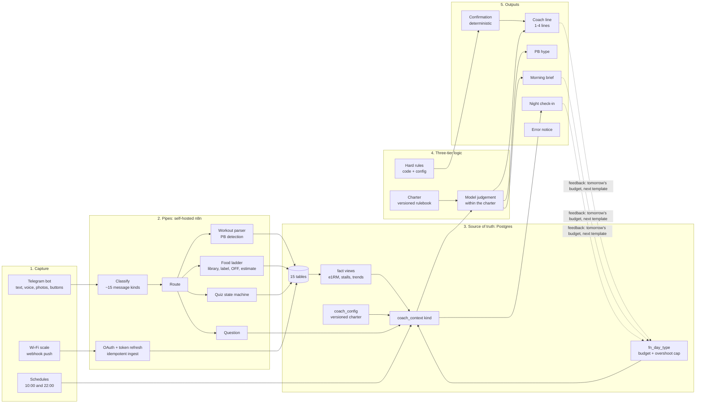

# fitness-coach-engine

An AI coaching system that turns messy human inputs (voice notes, photos, pasted gym notes, a Wi-Fi scale) into one Postgres source of truth, runs the analysis in SQL, and lets a language model talk only about verified facts within a versioned rulebook.

Built for personal use (training, nutrition, body composition) but the architecture is the interesting part, and it is the same shape as a GTM data pipeline: multi-source ingestion → deterministic classification and routing → system of record → hard rules in code, judgement in the model → outbound messages with a feedback loop.

This repo is a scrubbed showcase. **All data stays private.** It contains the workflow definitions, the database schema and the rulebook structure. It contains no weigh-ins, no food logs, no measurements, no check-in answers, no gut logs, no notes and no real food library. Every credential id, chat id, webhook id, hostname and token has been replaced with a `{{PLACEHOLDER}}`. CI enforces that on every push.

## Contents

| Path | What it is |
|---|---|
| `n8n/telegram-bot.json` | The bot: 126 nodes. Telegram trigger → classify → route → per-kind branch → confirmation → coach line. Food (voice, text, label photos, plate photos), workouts, tape, gut, notes, day type, free-form questions, the tap-through night check-in, error handling. |
| `n8n/digests.json` | Two schedules: 10:00 morning brief (model-written from `coach_context('digest_morning')`) and 22:00 night check-in (deterministic, inline buttons). |
| `n8n/withings-scale.json` | OAuth connect flow, token refresh, webhook-driven weigh-in ingest with idempotent upsert, a 09:45 safety poll, and the coach reaction. |
| `supabase/migrations/0001_tables.sql` | 15 tables. RLS on everywhere; the workflows use the service role. |
| `supabase/migrations/0002_functions.sql` | The hard rules: `fn_day_type`, `fn_kcal_target`, `prog_num`, a narrow destructive helper. |
| `supabase/migrations/0003_views.sql` | The fact views: `v_exercise_bests`, `v_exercise_trend` (stall detection), `v_session_top_sets` (e1RM), `v_weight_trend`, `v_nutrition_days`, `v_recovery`, `v_weekly_training`, `v_muscle_recency`, `v_stool_days`, `v_quiz_rows`. |
| `supabase/migrations/0004_coach_context.sql` | `coach_context(kind)`: the one RPC that assembles the model's fact document, sliced per event type. |
| `supabase/migrations/0005_seed_config.sql` | Programme keys and one sample charter version (illustrative; the real charter is private). |
| `scripts/` | What CI runs: workflow structure and syntax checks, a scrub sweep, migrations applied to a fresh Postgres with smoke tests. |
| `.env.example` | Every placeholder the workflows reference. |

## Architecture

### 1. Capture

Everything enters through one Telegram bot plus one zero-touch sensor.

- Workouts: a pasted note in a fixed format (title, exercise headers, `weight x reps` lines with bracketed commentary). A parser turns it into one row per set, learns exercise aliases at runtime from history, separates warm-ups from working sets, and flags all-time PBs scoped per gym for machine lifts.
- Food: voice notes (Whisper, then the model), text starting `food`, a photo of a packaging label (single or an album, buffered by `media_group_id` and gated so one execution wins), or a plate of food with a caption.
- Body: tape measurements, gut quality on the Bristol scale, day-type overrides, free-form notes and questions.
- Weight: a Withings Body scale. Step on, Withings fires a webhook, the workflow refreshes the OAuth token if needed, fetches the reading and upserts it on the provider's group id so a redelivery can never double-log.
- Night check-in: a tap-through quiz on inline buttons (energy, mood, soreness, hunger, substances, bowel count, note). It re-sends itself with updated numbers if anything is logged while it is open.

### 2. Pipes

Three workflows on a self-hosted n8n (Hetzner, moved off n8n Cloud on day two).

The bot is `Telegram Trigger → Classify → Route → branch`. Classify is one Code node that reads the update and assigns exactly one of ~15 kinds (workout, weight, tape, food, label, nolabel, help, question, callback, quizreply, note, daytype, stool, template, fallback). Order matters: specific grammars are matched before the catch-all `question` kind. Route is a Switch with one output per kind. Every branch ends in a deterministic confirmation reply, then a coach step.

Patterns worth noting in the JSON:

- Status bubble edited in place (`editMessageText`) so one event is one message: the deterministic part is sent immediately, the model's part is appended when it arrives 4-6s later.
- Every read against PostgREST paginates (limit 1000, offset) because the API caps responses.
- Upserts use `on_conflict` + `Prefer: resolution=merge-duplicates`; PostgREST only writes the columns in the body, so the weight upsert and the food-totals upsert on `daily` never overwrite each other.
- Fan-out write order is deliberate: `foods` lands before `food_log` so the foreign key holds.
- Model responses are parsed defensively (`claudeJSON` strips any fence, then slices from the first `[`/`{` to the last) because fencing is not reliable.
- An Error Trigger inside the bot sends a one-line failure notice with the failing node, so a crash is never silent.
- Effort tiers per event: low for a weigh-in (2k tokens), medium for food and questions (3k), high for a workout (6k). Prompt caching on the charter block.

### 3. Source of truth

Postgres on Supabase. Column names match the Google Sheet tabs the system was migrated from on day one (flat and a little denormalised on purpose).

The analysis lives in SQL, not in the model:

- `v_session_top_sets` / `v_exercise_bests`: top set per exercise per session, Epley e1RM with reps capped at 12, all-time bests with date and gym.
- `v_exercise_trend`: last six sessions per lift, machine and cable lifts scoped to the most recent gym, and a `stalled_4` flag that needs four sessions since the programme's `baseline_date` so old history cannot trip it.
- `v_weight_trend`: 7-day rolling average and change vs the previous week. The single reading is noise; this is what everything reads.
- `fn_day_type(date)`: the hard rule for "what day is it and what is the budget". Precedence: a session logged today → the user's override → a proposal from the rotation and recent volume. Applies yesterday's overshoot as a capped correction. Every consumer (morning brief, food reply, day-type reply) quotes this one function, so the scale, nutrition and training always agree.
- `coach_context(kind)`: one RPC that assembles the model's fact document sliced per event (a weigh-in gets ~11KB, a food event ~14KB, the weekly review everything at ~45KB). The charter is the first block of every slice.

### 4. Three-tier logic

The architecture decision. Nothing important is left to the model's judgement.

1. Hard rules in code and config. Calorie budgets, the protein floor, the overshoot cap, the +10%/-5% safety margin on photo estimates, rest periods, what counts as a PB, the duplicate rule. Deterministic, testable, changed in one place.
2. The charter. A versioned document in `coach_config` holding the coaching philosophy and the tone and layout rules. The model receives it on every call as a cached system block. Changing the coach's behaviour means inserting version n+1 and flipping `active` (a partial unique index guarantees one active row); the n8n prompts do not change. Two front ends (the Telegram bot and a chat assistant used for programme review) read the same charter so they never drift.
3. Model judgement within the charter. The model writes the coach line, the morning brief and the PB message from the facts, and is told to use only numbers from them and to reply `NONE` when there is nothing to add.

### 5. Outputs

- Confirmation after every log, with the numbers, deterministic.
- One composed food reply per update: items logged, calories/protein/fibre eaten and remaining against today's day-type budget, a recap of the day, pending asks, then the coach's "to finish the day" appended to the same bubble.
- A PB message when a set beats an all-time best (its own prompt and voice).
- A coach line after every event: 1-4 lines, charter-driven, `NONE` suppressed.
- Morning brief at 10:00: weight trend, yesterday's recap, today's day type and budget with how it was decided, protein plan, training, anything due.
- Night check-in at 22:00.
- Error notice on any crashed run.

### 6. The feedback loop

Scale reading → `fn_day_type` sets today's budget → the food reply judges meals against it → a workout is logged → volume per muscle and stall flags update → the morning brief proposes tomorrow → the night check-in captures the subjective signals (hunger, soreness) that predict whether the plan is sustainable before the scale moves.

## How this was built

- Specified in plain English, built by an AI assistant with direct access to n8n (via the n8n MCP connector) and to Postgres (via the Supabase MCP connector). The owner describes behaviour ("every food update gets exactly one reply, with these sections, in this order"), the assistant edits the live workflow and schema, the owner tests from the phone.
- Roughly four days from a Google Keep export to a working system with the coaching layer. Day one: parse 430+ historical sessions, build the bot against a Sheet, migrate to Postgres that evening. Day two: coaching layer, digests, self-hosting. Days three and four: scale integration, photo albums, the single food reply, error handling.
- A build log recorded what landed and every gotcha found, so a fresh session could pick up where the last left off. Some of the gotchas now live as comments in the SQL and the Code nodes: `executeOnce` on a Code node means "first item only"; `$input` is the immediate predecessor only; HTTP Request nodes do not pick up credentials on creation; n8n drops an expression placed on an inline-keyboard parameter at runtime, so keyboards are static per node and the text varies instead.
- Validation is in CI: every workflow JSON is structurally checked and every Code node syntax-checked; every migration is applied, in order, to a fresh Postgres 17 and the functions are exercised; gitleaks and a project-specific scrub sweep run on every push.

## Running it yourself

You would need a Telegram bot, a Supabase project, an n8n instance, Anthropic and OpenAI keys, and (optionally) a Withings developer app. Copy `.env.example`, provision those, apply the migrations in order, substitute the placeholders in the workflow JSON, import the three workflows and create the four credentials under the names the nodes reference. The sample charter in `0005_seed_config.sql` is generic; write your own.

This is published as a reference, not a product. Issues are welcome; support is not promised.

## What is deliberately not here

- Any row of personal data: weigh-ins, food logs, measurements, check-in answers, gut logs, substance fields, notes, workout history.
- The real food library and the real charter text (the structure of both is here; the content is personal).
- Credential ids, API keys, bot tokens, chat ids, webhook ids, project refs, hostnames, OAuth secrets.
- The dashboard artifact and the two one-off loader workflows used for the historical import.

## Licence

MIT.
